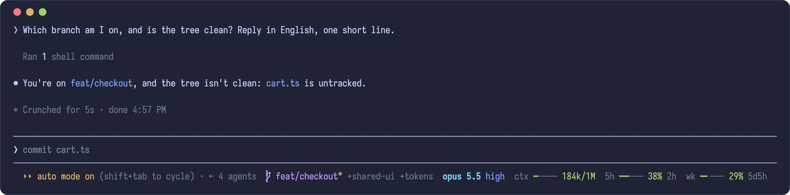
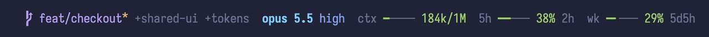
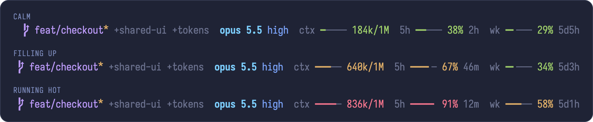
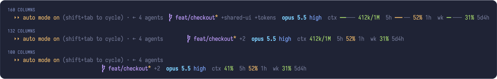

<div align="center">

# footline

**Everything you keep checking in Claude Code, on one row of the footer.**

Branch and its pull requests, model, effort, context, and how long your limits have left.
No extra rows, no script to run, nothing to configure.

[](LICENSE)
[](#install)

<br>



</div>

## Install

At the prompt of a terminal session:

```
/plugin install footline --marketplace aspatari/footline
```

Answer `y` to add the marketplace, then pick a scope. The row appears in that session, and under the user scope in every session after it.

<details>
<summary>From a shell, or in the desktop app</summary>

From a shell:

```
claude plugin install footline --marketplace aspatari/footline
```

In the desktop app, where `/plugin` does not run: click **+** next to the prompt box, then **Plugins**, **Add marketplace** with `aspatari/footline`, then **Add plugin**.

</details>

## Watch it move



## What's on the row

| Part | Looks like | What it tells you |
| --- | --- | --- |
| **Branch** | `feat/checkout*` | The current branch, with `*` when the tree has changes. Refreshed every 10 seconds, so a switch from another terminal shows up too. |
| **Pull requests** | `#392✓` | The current branch's PR, plus the ones this session made or worked on with `gh pr` or a GitHub tool, even from another worktree. Green is open, grey a draft, purple merged, red closed; then `✓` checks pass, `●` running, `✗` failing. Up to three, refreshed every minute. |
| **Added directories** | `+shared-ui +tokens` | What `/add-dir` and `permissions.additionalDirectories` added. Past three the rest are counted: `+one +two +three +2`. |
| **Model and effort** | `opus 5.5 high` | The model, short. Effort comes from your settings, then from what the last turn really ran on. |
| **Context** | `ctx ━──── 184k/1M` | How full the context window is. |
| **5-hour limit** | `5h ━━─── 38% 2h` | How much is used, and the time left to its reset. |
| **Weekly limit** | `wk ━╸─── 29% 5d5h` | How much is used, and the time left to its reset. |

The time left reads `30m`, `3h` or `3d5h`.

## Colour means something

Green is fine, yellow is past 50%, red is past 75%. You see trouble before you read a number.



Colours come from your Claude Code theme, so under a theme like `dark-ansi` they follow your terminal's own palette. The shots here use Tokyo Night.

## Fits your terminal

The row is laid out by its real length. When space runs out the directory names become a count, then the bars go. On a narrow terminal it moves to a second row rather than cutting anything off.



## Good to know

- **Font.** The branch glyph (U+E0A0) needs a Powerline or Nerd Font. The shots use Iosevka Term Nerd Font.
- **Limits** need a Claude subscription, and can appear only after the first response of a session.
- **`--add-dir` isn't shown.** Claude Code doesn't tell a mod about directories given with that flag. `/add-dir` works, and those stay listed until the process ends.
- **Pull requests** need the [GitHub CLI](https://cli.github.com) signed in. A PR from another repository shows as `name#12`.
- **Footer labels.** footline draws its row where the footer's dim mode labels sit, and keeps their text in front of it.

## Develop

```
claude plugin validate .
claude plugin test .
```

The shots are real Claude Code sessions in a demo repository. The usage numbers in them come from a demo fixture, not a real account.

## License

[MIT](LICENSE)
